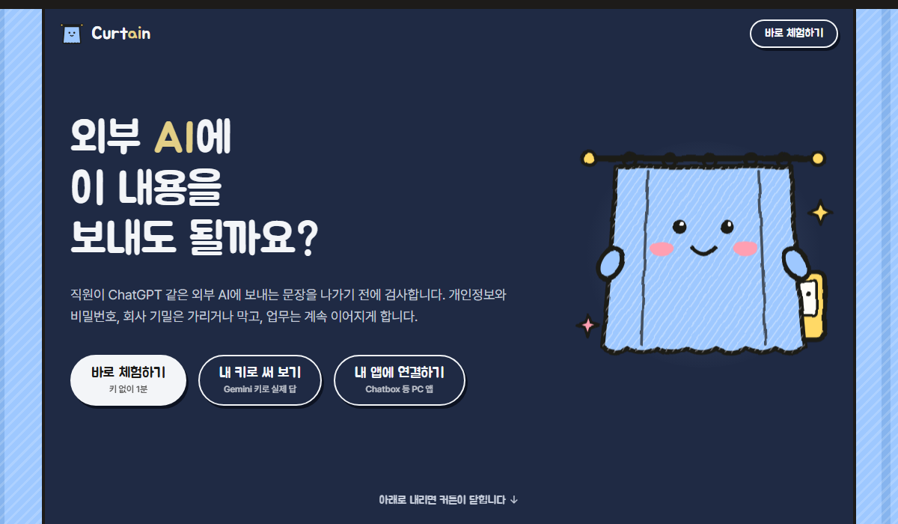
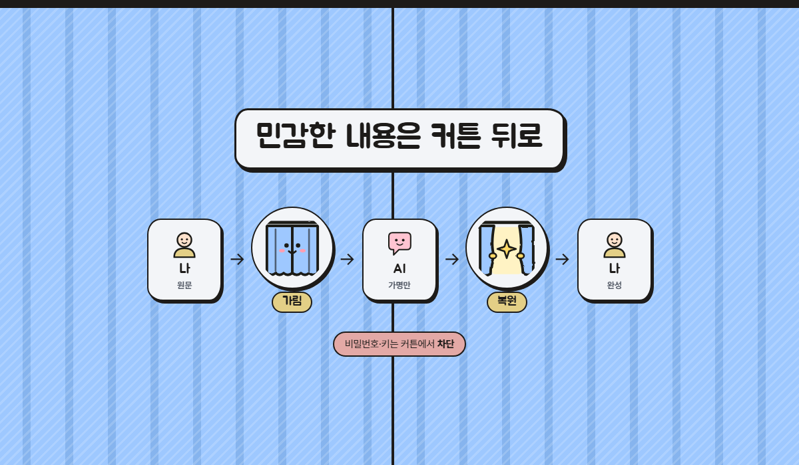

# Curtain

**외부 AI에 보내는 문장에서 민감한 값만 커튼 뒤로 가리는 정보 유출 방지 게이트웨이.**

회사 직원이 ChatGPT 같은 외부 생성형 AI에 보내는 문장을 **나가기 전에** 검사한다. 개인정보와 회사 기밀은 가명으로 바꿔 보내고 돌아온 답에서 원래 값으로 되돌리며, 비밀번호와 키는 아예 보내지 않는다. 학습용 포트폴리오 프로젝트이며 실제 서비스가 아니다.

- **공개 시연:** <https://curtain-h8id.onrender.com/> (설치 없이 바로. 무료 서버라 한동안 접속이 없으면 잠들어 첫 접속은 1분쯤 걸린다)
- **저장소:** <https://github.com/HTH-0/Curtain> (이전 이름 Deskguard, 2026-11-02 변경)



## 어떻게 동작하나



| 처리 | 조건 | 동작 |
|---|---|---|
| 허용 | 탐지된 값이 없다 | 그대로 외부 AI로 보낸다 |
| 가림 | 개인정보(D1)나 회사 코드명, 고객사(D3)가 있다 | 값을 `[전화1]` 같은 가명으로 바꿔 보내고, 답이 돌아오면 원래 값으로 되돌려 보여 준다 |
| 경고 | 개인정보가 많다(20개 이상) | 포털에서는 확인을 받은 뒤 가려서 보낸다(AI 앱 연결에서는 확인할 방법이 없어 자동으로 가린다) |
| 차단 | 자격증명(D2)이나 보안 등급 표시가 있다 | 보내지 않고 이유를 알린다 |

- 탐지는 정규식, 검증 숫자(카드 번호 등), 회사 사전으로 한다. **검사를 위해 민감한 문장을 다른 외부 서비스로 보내지 않는다.**
- 로그에는 원문, 탐지한 값, 가명 대응표, API 키를 남기지 않는다(처리, 항목별 개수, 길이, 해시, 지연만 남긴다).
- 왜 만드는지는 [문제 정의서](./docs/problem.md), 탐지 항목과 정책은 [정책서](./docs/policy.md)에 있다.

## 써 보기

공개 사이트에서 아래로 내리면 세 구간이 차례로 나온다.

| 구간 | 하는 일 |
|---|---|
| **바로 체험하기** | 포털의 예시 버튼(가림 파랑, 차단 빨강, 경고 주황, 허용 초록)을 눌러 본다. 키가 없으면 **시연 모드**라 외부 AI를 부르지 않는다. 예시에는 미리 써 둔 모범 답이 오고, 답 속 가명은 실제로 복원된다 |
| **내 키로 써 보기** | 내 Gemini 키([Google AI Studio](https://aistudio.google.com/apikey)에서 무료 발급)를 넣으면 같은 포털에서 실제 Gemini의 답을 받는다 |
| **내 앱에 연결하기** | Chatbox 같은 OpenAI 방식 앱의 API 호스트에 사이트 주소, API 키에 내 Gemini 키, 모델에 `curtain`을 넣으면 내 PC의 앱도 Curtain을 거친다 |


가림이 일어나면 답마다 **커튼 기록**이 붙는다: 내가 쓴 문장(가려진 값), AI가 받은 문장(가명), 답에서 되돌린 값(밑줄). 답 위에는 `실제 Gemini 답` 또는 `시연용 예시 답`이 표시된다.

**키 처리 원칙(FR-12):** 키는 방문자의 브라우저 탭에만 보관하고 탭을 닫으면 사라진다. 요청마다 헤더로 서버에 보내고, 서버는 그 요청에만 쓰며 저장하거나 기록하지 않는다. Gemini에도 주소가 아니라 헤더로 보낸다. 다른 서비스의 키를 Google로 보내지 않도록 Google 키 형식(`AIza…`, `AQ.…`)만 받는다.

> 공개 시연 서버에서는 원문이 서버까지는 간다(저장하지 않는다). 실제 개인정보는 넣지 않는다. 회사에서 실제로 쓰려면 같은 서버를 **회사 안에 설치**해 원문이 회사 밖으로 나가지 않게 하는 것이 이 제품의 전제이다.

## 측정 결과

평가 세트는 생성형 AI 3종이 만든 업무 요청 틀에 코드가 만든 **가짜 값**을 채운 합성 문장이다(596문장). 측정 전에 평가 세트, 탐지 설정, 대량 기준을 해시로 동결했고 결과를 보고 규칙을 바꾸지 않았다. 윌슨 95% 구간은 괄호에 적었다. 자료와 재현 방법은 [평가 자료](./docs/eval/README.md)에 있다.

| 지표 | 결과 |
|---|---|
| X: 개인정보(D1) 탐지율 | 98.1% (97.0~98.8%) |
| X: 자격증명(D2) 탐지율 | 81.7% (75.4~86.6%) |
| X: 회사 기밀(D3) 탐지율 | 100% (96.8~100%) |
| Y: 정상 문장 오탐율 | 0 / 106 (0~3.5%) |
| T: 검사, 가림, 복원 지연 | 서버 중앙값 0ms, 95백분위 1ms 이하 |
| 우회 시험(변형 96문장) | 25개만 탐지(26%), 변형하지 않은 대조는 24/24 ([보고서](docs/eval/results/report_bypass_v1.md)) |
| Z: 가림 후 답의 쓸모 | 사람 판정 45쌍: 원문으로 쓸 수 있는 답 36개 중 33개는 가려서 보내도 쓸 수 있음(91.7%, 약 78~97%). 복원 성공 92.0%. 자동 채점(Jev)은 사람과 48.9%만 일치해 채택하지 않음([보고서](docs/eval/results/report_z_v1.md)) |
| Z 2차: 가림 요청에 가명 안내문을 붙였을 때 | 값 보존 84.5% → 99.6%(코드 지표), 복원 성공 92.0% → 93.9%(차이 불확실). 사람 판정은 하지 않음([보고서](docs/eval/results/report_z2_v1.md)) |

**한계를 먼저 적는다.**

- 놓친 정답은 **비밀번호**(값만 있는 형태 33건)와 **계좌 번호**(은행이나 "계좌" 같은 문맥어가 없는 형태 16건) 두 항목뿐이다. 규칙 기반 탐지는 값 모양만으로 이 둘을 구분하지 못한다.
- 합성 문장이라 실제 직원 문장보다 탐지율이 높게 나왔을 수 있다. D3의 100%는 사전과 같은 값을 넣었기 때문이다(사전에 없는 이름은 탐지하지 못한다).
- 우회에 약하다. 전각 숫자, 한글 숫자(`공일공…`), 이메일 `at` 표기, 키 쪼개기, 글자 띄어쓰기, 보이지 않는 문자를 넣으면 대부분 통과한다. 입력 정규화는 후속 개선 후보이다.
- 사용자 인증과 요청 수 제한이 없다. 모델이 답에 가명을 쓰지 않으면 복원할 것이 없다. 남은 위험은 [open-risks.md](./docs/open-risks.md)에 있다.

## 실행하기

필요한 것: JDK 25, Maven 3.9, Python 3. API 키 없이 시연과 시험이 된다.

```bash
# 키 없이 시연 (http://localhost:8080). 공개 사이트와 같은 모드이며, 화면에서 내 키를 넣으면 실제 Gemini를 쓴다
cd backend
mvn spring-boot:run "-Dspring-boot.run.arguments=--gateway.demo-answer=true"

# 서버 키로 실제 Gemini (환경변수 GEMINI_API_KEY 필요, 키는 파일이나 대화에 쓰지 않는다)
mvn spring-boot:run

# 자동 시험 (키 없이 통과한다: Java 183건, Python 79건)
cd backend && mvn -B test
cd backend/scripts && python -m unittest test_fake_values test_measure test_build_eval_set test_build_bypass_set test_z_measure
```

- 측정(X·Y·T, 우회, Z)의 재현 방법은 [docs/eval/README.md](./docs/eval/README.md)에 있다.
- 공개 배포는 저장소의 `Dockerfile`(시연 모드, 키 없음)로 Render에서 한다. `main`에 올리면 자동으로 다시 배포된다.

## 기존 AI 도구를 연결하기 (OpenAI 호환 입구)

게이트웨이는 `POST /v1/chat/completions`와 `GET /v1/models`를 연다. OpenAI 방식으로 말하는 도구(Chatbox, 공식 OpenAI SDK 등)는 **서버 주소만 바꾸면** 모든 대화가 검사를 거친 뒤 Gemini로 나간다.

| 설정 | 값 |
|---|---|
| 주소(Base URL) | `https://curtain-h8id.onrender.com/v1` 또는 `http://localhost:8080/v1` (Chatbox는 API 호스트에 `/v1` 없이) |
| API 키 | 내 Gemini 키(그 요청에만 쓴다). 형식이 아닌 값이면 서버 기본 응답(공개 서버는 시연) |
| 모델 | `curtain` |

```python
from openai import OpenAI
client = OpenAI(base_url="http://localhost:8080/v1", api_key="내 Gemini 키 또는 아무 값")
print(client.chat.completions.create(model="curtain",
      messages=[{"role": "user", "content": "김민수 010-2345-6789 에게 안내 메일 써 줘"}]).choices[0].message.content)
```

- 가림이면 답 맨 앞에 `[Curtain] 휴대전화 1건을 가려서 보냈습니다.` 같은 한 줄이 붙고, 가명은 원래 값으로 되돌려진다. 차단이면 403 오류(`curtain_blocked`)로 알린다.
- 대화는 서버에 저장하지 않는다. 클라이언트가 매 턴 대화 전체를 다시 보내므로 매번 처음부터 가린다.
- 글자만 받는다(이미지와 도구 호출은 400). Chatbox는 모델 설정에서 이미지와 `도구 사용`을 꺼 둔다. 대화 전체는 2만 자까지이다.

## 구조

```
backend/src/main/java/com/promptgateway/
  detect/      탐지(개인정보, 자격증명, 회사 사전)와 처리 결정
  mask/        가림(가명 만들기)과 복원
  gateway/     처리 순서(포털용 ChatGateway, 대화용 ConversationGateway)
  controller/  포털 API(/api/chat, /api/info)
  compat/      OpenAI 호환 입구(/v1)
  service/     응답 모델(서버 키 Gemini, 방문자 키 Gemini, 시연 응답)
  log/         감사 로그(원문과 값 없이 한 줄)
backend/src/main/resources/static/   포털 화면 한 장(외부 라이브러리 없음, 글꼴과 그림은 저장소에 직접)
backend/scripts/                     평가 세트 생성과 측정 도구(Python)
docs/                                문제 정의, 정책, 명세, 설계, 평가 자료, 작업 기록
```

## 개발 방식과 역할

SDD와 TDD를 병행했다. 기획은 문제 정의 → 정책 → 명세([`spec.md`](./docs/spec.md)) → 설계([`design.md`](./docs/design.md)) → 작업 목록([`tasks.md`](./docs/tasks.md)) 순서로 확정하고, 구현은 수용 기준(AC)에서 실패하는 시험을 먼저 쓴 뒤 최소 코드로 통과시켰다. 구현 중에 명세의 빈칸이 드러나면 코드보다 명세를 먼저 고쳤다. 탐지율처럼 확률적인 품질은 시험이 아니라 측정으로 검증했다. 결정의 근거는 [`DECISIONS.md`](./DECISIONS.md)에 후보, 선택, 이유로 남겼다.

| 역할 | 사용자 | AI(Claude Code) |
|---|---|---|
| 기획 | 주제와 범위 결정, 문제 정의 확정, 각 단계 계획 승인 | 문서 초안, 후보 비교와 권고 |
| 구현 | 방향 결정과 검토(예: 내 키로 쓰기, 커튼 기록, 디자인 방향) | 시험과 코드 작성, 문서 갱신 |
| 검증 | 실제 Gemini, Chatbox, 공개 사이트에서 직접 확인, Z 사람 판정 | 자동 시험, 가짜 Gemini와 브라우저 자동화로 확인, 측정 도구 실행 |
| 디자인 | 화풍, 캐릭터, 색, 문구 결정 | 그림(SVG)과 화면 구현 |

주제를 한 번 바꿨다(2026-10-29, 사내 HR 헬프데스크 챗봇의 입력 가드레일에서 정보 유출 방지 게이트웨이로). 이전 자료는 [`docs/archive/`](./docs/archive/README.md)에 있고 경위는 [작업 일지](./docs/worklog.md)에 있다. 이어서 작업하려면 [`docs/handoff.md`](./docs/handoff.md)를 먼저 읽는다.

## 데이터 출처와 라이선스

| 자료 | 어디에 있나 | 출처와 조건 |
|---|---|---|
| 업무 요청 틀, 평가 세트의 값 | `docs/eval/` | 생성형 AI가 만든 문장과 무작위 가짜 값 |
| 글꼴 Pretendard, Jua | `backend/src/main/resources/static/fonts/` | SIL Open Font License 1.1 |
| 그림(커튼 캐릭터 등) | `backend/src/main/resources/static/img/` | 이 프로젝트에서 직접 그린 SVG |
| deepset/prompt-injections, JailbreakBench | `docs/archive/dataset.csv`의 일부 행(주제를 바꾸기 전 자료, 보관) | Apache-2.0, MIT(인용 요청 있음) |
| KOICA 인사규정 질의응답 세트 | `docs/archive/eval-hr/`(보관) | 한국국제협력단, 공공데이터포털, 이용허락범위 제한 없음(출처 표시) |

전체 출처, 라이선스 전문, 인용은 [THIRD_PARTY_NOTICES.md](./THIRD_PARTY_NOTICES.md)에 있다. 이 저장소의 자체 코드와 문서의 라이선스는 아직 정하지 않았다.
